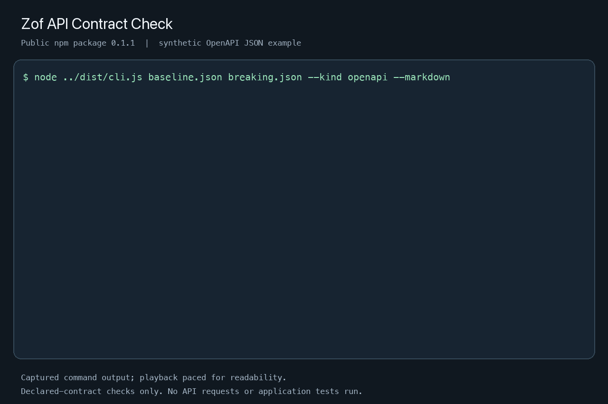

# Zof API Contract Check

Flag breaking changes in supported OpenAPI JSON contracts before merge. Compare two local files and get a finding such as: **the response field `id` changed from integer to string**. Runs offline without a Zof account or source upload.

Use this for OpenAPI 3.0/3.1 JSON contracts or the documented JSON Schema subset. YAML, `allOf`/`oneOf`/`anyOf`, and external references are unsupported and return an incomplete-analysis error. See [supported scope](docs/LIMITATIONS.md) before trying your own contract.



Captured from the public 0.1.1 package using synthetic examples; playback is paced for readability. The commands and findings are written out below. [Terminal recording](docs/media/contract-check.cast).

<!-- ZOF_NPM_INSTALL_START -->
## Install from npm

Use **Node.js 22 or 24**, npm, and **Linux or macOS with Python 3.10+**. Windows file operations fail closed. In a new project directory, install the published version and run its deliberately breaking example:

```sh
npm install --ignore-scripts --save-exact @zof-ai/api-contract-check@0.1.1
npx --no-install zof-api-contract-check baseline.json breaking.json --root node_modules/@zof-ai/api-contract-check/examples --kind openapi --markdown
```

The command exits **1**, as intended. Its finding is:

```text
- **high** type-incompatible: The accepted or returned value type is incompatible. (GET /items/responses/200/schema/properties/id)
```

The full report also lists the analysis limitations. The baseline declares `id` as an integer; the candidate declares a string. A client expecting an integer needs review before that change is released.

Compare the compatible example next:

```sh
npx --no-install zof-api-contract-check baseline.json compatible.json --root node_modules/@zof-ai/api-contract-check/examples --kind openapi --json
```

This command exits **0** and reports `compatible: true` for the supported checks. Neither command runs an API, sends requests, or proves runtime compatibility.

The package includes compiled JavaScript, TypeScript declarations, runtime dependencies, and synthetic examples. `--ignore-scripts` disables installation lifecycle scripts; `--no-install` keeps later commands from downloading another package. Package: [@zof-ai/api-contract-check](https://www.npmjs.com/package/@zof-ai/api-contract-check).
<!-- ZOF_NPM_INSTALL_END -->

## Check your own contract

Place the baseline and candidate inside one explicit directory:

```sh
npx --no-install zof-api-contract-check baseline.json candidate.json --root contracts --kind openapi --markdown
```

For standalone JSON Schema files, use `--kind json-schema`; the comparison describes accepted inputs, so a narrower candidate constraint is incompatible. Default reports are Markdown; `--json` produces structured findings. An optional `--policy policy.json` is resolved under the same root and can change severity and the failure threshold without removing findings.

| Exit code | Meaning | CI treatment |
| --- | --- | --- |
| 0 | Completed supported checks below the policy threshold | Check succeeded |
| 1 | Findings meet the failure threshold | Review the contract change |
| 2 | Invalid, unreadable, unsupported, or incomplete input | Fix the input or coverage gap; never count as a pass |

## Add a pull-request check

Copy the [complete GitHub Actions workflow](examples/github-actions/api-contract.yml) to `.github/workflows/api-contract.yml`, then change its two `openapi.json` paths to your contract's repository-relative path. The workflow compares the PR's exact base and head commits using this package's CLI. It installs the tool separately and does not install or execute the checked-out application's code.

Read the [CI quickstart](docs/CI.md) for prerequisites, path configuration, branch protection, and the workflow's limits. The separate Zof GitHub Action performs generic source checks; this workflow calls **API Contract Check** directly.

## Three practical walkthroughs

The [walkthroughs](docs/WALKTHROUGHS.md) use the published npm package and synthetic inputs:

1. A response field changes from integer to string.
2. A new required query parameter breaks callers that omit it.
3. An authentication declaration changes during a rollout.

Each includes a runnable command, actual finding, expected exit code, and a follow-up check. These are reproducible teaching examples, not customer outcomes.

## Library

```js
import { compareContracts, readContract, renderMarkdown } from '@zof-ai/api-contract-check';
const baseline = await readContract(process.cwd(), 'baseline.json');
const candidate = await readContract(process.cwd(), 'candidate.json');
const report = compareContracts(baseline, candidate, { failOn: 'high' });
console.log(renderMarkdown(report));
```

See the [API reference](docs/API.md) for supported options and findings.

## Install from GitHub source

For source builds, use the [pinned source installation and development guide](docs/DEVELOPMENT.md). npm consumers can use the quickstart above without building this repository.

See [limitations](docs/LIMITATIONS.md), [security](SECURITY.md), [contributing](CONTRIBUTING.md), and [release gates](docs/RELEASE.md). No telemetry or hosted integration is implemented. Independently authored and licensed under [Apache-2.0](LICENSE).
